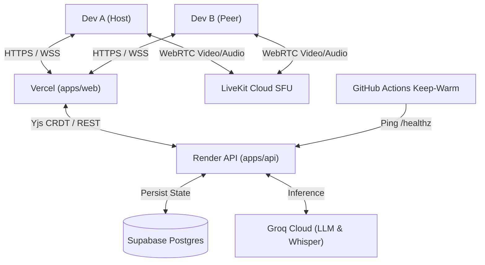

# Runbook & Operations Guide — Pairio-Lite

This runbook guides local development, production deployment to free-tier cloud services, and pre-flight demo verification for **Pairio-Lite "Pair Master"**.

---

## 1. Production Deployment Guide (100% Free Tiers)

Pairio-Lite is architected to run completely within permanent free tiers:
- **Frontend**: **Vercel** (Next.js Edge/Serverless)
- **Backend**: **Render** (Free Web Service)
- **Database**: **Supabase** (Free PostgreSQL + Realtime)
- **WebRTC SFU**: **LiveKit Cloud** (5,000 participant-min/month free)
- **AI / Speech**: **Groq Cloud** (Free LLM & Whisper Turbo)



---

### Step 1: Push Code to GitHub

1. Confirm working tree is clean and secrets are not tracked:
   ```bash
   git status
   ```
2. Create a new GitHub repository (e.g. `pairio-lite`).
3. Add the remote and push:
   ```bash
   git remote add origin https://github.com/<YOUR_GITHUB_USERNAME>/pairio-lite.git
   git branch -M main
   git push -u origin main
   ```
   *(Note: `.env` and `apps/web/.env.local` are automatically ignored by `.gitignore` so your API keys are never exposed).*

---

### Step 2: Supabase Setup (Database)

1. Go to **[supabase.com](https://supabase.com)** and create a new project.
2. In the Supabase Dashboard, click **SQL Editor** in the left menu.
3. Open [supabase/migrations/20261021_initial_schema.sql](file:///c:/Users/ASUS/Downloads/pairio%20browser%20proto/supabase/migrations/20261021_initial_schema.sql), copy its contents, paste them into the SQL Editor, and click **Run**.
4. Go to **Settings ⚙️ -> API** and copy:
   - `Project URL`
   - `anon` `public` key
   - `service_role` `secret` key

---

### Step 3: Render Deployment (FastAPI Backend)

1. Go to **[dashboard.render.com](https://dashboard.render.com)** and click **New + -> Web Service**.
2. Connect your GitHub repository (`pairio-lite`).
3. Configure settings:
   - **Name**: `pairio-lite-api`
   - **Root Directory**: `apps/api`
   - **Environment**: `Python 3`
   - **Build Command**: `pip install -r requirements.txt`
   - **Start Command**: `uvicorn main:app --host 0.0.0.0 --port $PORT`
   - **Plan**: `Free`
4. Under **Environment Variables**, add:
   | Key | Value |
   |---|---|
   | `ENVIRONMENT` | `production` |
   | `PORT` | `10000` |
   | `CORS_ORIGINS` | `https://<YOUR-VERCEL-APP>.vercel.app` (or `*` temporarily) |
   | `JWT_SECRET` | *(Random 32-character hex string)* |
   | `GROQ_API_KEY` | *(Your Groq API key)* |
   | `SUPABASE_URL` | *(Your Supabase URL)* |
   | `SUPABASE_KEY` | *(Your Supabase anon key)* |
   | `SUPABASE_SERVICE_ROLE_KEY` | *(Your Supabase service role key)* |
   | `LIVEKIT_URL` | *(Your LiveKit wss:// URL)* |
   | `LIVEKIT_API_KEY` | *(Your LiveKit API Key)* |
   | `LIVEKIT_API_SECRET` | *(Your LiveKit Secret)* |
5. Click **Create Web Service**. Once deployed, copy your Render URL (e.g. `https://pairio-lite-api.onrender.com`).

---

### Step 4: Vercel Deployment (Next.js Frontend)

1. Go to **[vercel.com](https://vercel.com)** and click **Add New -> Project**.
2. Select your GitHub repository (`pairio-lite`).
3. Configure project settings:
   - **Framework Preset**: `Next.js`
   - **Root Directory**: Click *Edit* and select **`apps/web`**.
4. Under **Environment Variables**, add:
   | Key | Value |
   |---|---|
   | `NEXT_PUBLIC_API_URL` | `https://pairio-lite-api.onrender.com` |
   | `NEXT_PUBLIC_WS_URL` | `wss://pairio-lite-api.onrender.com` |
   | `NEXT_PUBLIC_LIVEKIT_URL` | `wss://pair-6oire81l.livekit.cloud` |
5. Click **Deploy**.
6. Once deployed, update `CORS_ORIGINS` in your Render backend settings with your live Vercel domain (`https://pairio-lite.vercel.app`).

---

### Step 5: Keep-Warm Heartbeat Configuration

Render free instances spin down after 15 minutes of inactivity. To ensure zero cold starts when demoing to Mark:

1. In your GitHub repository, go to **Settings -> Secrets and variables -> Actions**.
2. Add the following repository secrets:
   - `RENDER_API_URL`: `https://pairio-lite-api.onrender.com`
   - `SUPABASE_URL`: `https://<your-project>.supabase.co`
   - `SUPABASE_KEY`: *(Your Supabase anon key)*
3. The workflow [.github/workflows/keep-warm.yml](file:///c:/Users/ASUS/Downloads/pairio%20browser%20proto/.github/workflows/keep-warm.yml) automatically pings `/healthz` every 10 minutes to keep instances warm.

---

## 2. Emergency Troubleshooting ("What to do if something breaks")

| Symptom | Probable Cause | Action |
|---|---|---|
| **`/healthz` returns 503 / DB error** | Supabase project paused due to inactivity | Open Supabase dashboard, unpause project, run keep-alive query. |
| **API cold start delay (~45s)** | Render free tier instance spun down | Ping `/healthz` 5 minutes prior to demo or trigger `Keep-Warm Heartbeat` workflow manually. |
| **Groq 429 Rate Limit** | TPM/RPM limit hit on primary model | Fallback to `gpt-oss-20b` activates automatically; check remaining quotas in `scripts/check_services.py`. |
| **WebRTC Media not connecting** | LiveKit credentials invalid or exhausted quota | Confirm `LIVEKIT_URL`, `LIVEKIT_API_KEY`, `LIVEKIT_API_SECRET`. Code editor and Pyodide sandbox continue functioning independently. |
| **Monaco CRDT sync disconnects** | WebSocket dropped during network switch | Client auto-reconnects with exponential backoff and resyncs state from Supabase/memory snapshot. |

---

## 3. Demo Pre-Flight Protocol (10 Minutes Prior to Demo)

1. Run `python scripts/check_services.py` to confirm all services respond green.
2. Curl `https://<api-domain>/healthz` to ensure Render is warm.
3. Open two clean browser profiles (e.g. Chrome + Chrome Incognito / Brave).
4. Create test room `/r/demo-preflight`, test two lines of live typing, click **Split Work**, test **Run** (Pyodide sandbox), and click **Join Call**.

